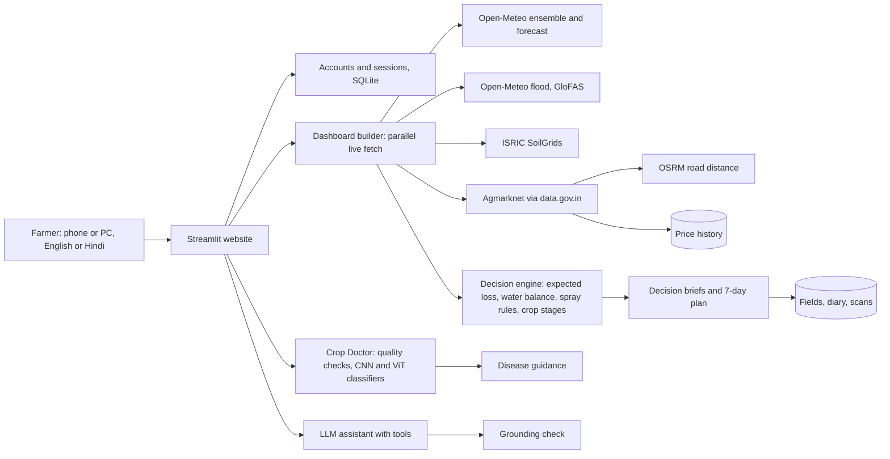

# FasalRaksha: farm decisions from live climate, soil, market and crop-photo data

A farmer signs in, registers fields, and gets stage-aware decisions in English or Hindi. Each decision comes with the evidence,
the options compared, a confidence level and what would change the advice.

**Track:** Climate, Resource Infrastructure and Global Supply Resilience.

## Features
- Accounts (mobile number and password, salted PBKDF2 hashes) and a database of fields, diary, sales, scans and price history.
- Field tracking: crop stage from sowing date, stage tips, expected maturity date.
- Decision briefs for irrigation, harvest timing and selling: recommendation, reasons, options table, confidence, triggers, next check.
- 7-day work plan that combines weather, irrigation, harvest, spray windows and stage changes.
- Probabilistic weather risk (51-member ECMWF ensemble), flood watch (GloFAS river discharge), frost and heat alerts.
- Crop Doctor: leaf photo, image-quality checks, MobileNetV2 CNN and ViT-tiny classifiers, guidance per disease.
- Best mandi by net price after road transport (Agmarknet via data.gov.in, OSRM), plus a price history the app builds as it runs.
- Diary and profit per field, WhatsApp sharing, assistant with tool calling and a numeric grounding check.

## Architecture


## Run on Windows (PowerShell)
```powershell
.\setup.ps1
.\.venv\Scripts\Activate.ps1
python check_llm.py
python check_data.py
.\install_cnn.ps1      # optional: photo models
streamlit run app.py
```

## Honest notes
- Crop loss, stage durations, water and spray thresholds are agronomic assumptions (`core/crops.py`, `core/stages.py`, `core/spray.py`).
  Replace with ICAR or state university values and cite them.
- Photo models were trained mostly on clean single-leaf images. Treat results as a first screening. Mustard is not covered.
- SQLite is a local file. On free hosting it may reset on restart. For real use, move to Postgres.
- Weather and flood data by Open-Meteo.com (CC BY 4.0). Soil data: ISRIC SoilGrids. Prices: Agmarknet via data.gov.in. Routes: OSRM, OpenStreetMap data.
- Confirm major decisions with your local Krishi Vigyan Kendra (KVK).
